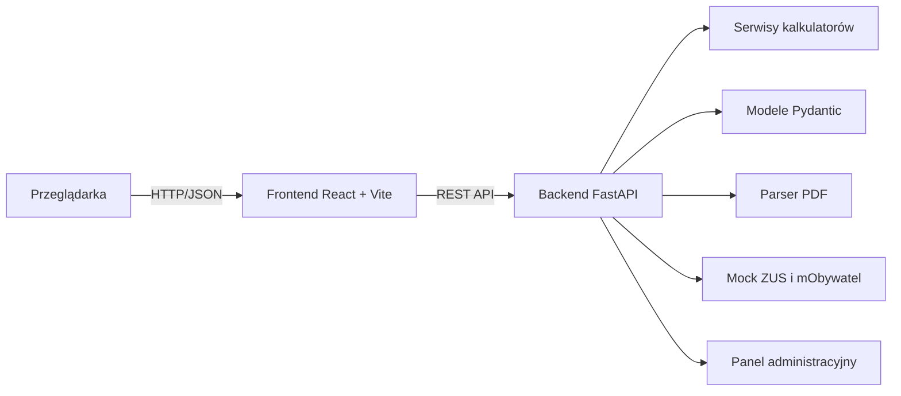

# Architektura

## Przegląd

Projekt jest monorepo z oddzielonym frontendem React i backendem FastAPI.



## Warstwa frontendowa

Frontend znajduje się w katalogu `frontend/`. Używa React 19, Vite, TypeScript oraz Tailwind CSS. Kontakt z backendem następuje przez HTTP na adres konfigurowany zmienną `VITE_API_URL`.

## Warstwa backendowa

Główna instancja API jest utworzona w `backend/src/api/api.py`. Klasa `MainAPI`:


1. tworzy aplikację FastAPI,
2. konfiguruje CORS,
3. rejestruje routery,
4. dodaje prefiksy ścieżek,
5. udostępnia dokumentację OpenAPI.

## Struktura backendu

```text
backend/src/
├── api/
│   ├── api.py
│   ├── models/      # modele wejścia i odpowiedzi Pydantic
│   ├── routers/     # endpointy HTTP
│   └── services/    # logika biznesowa i obliczenia
├── calculators/     # moduły pomocnicze kalkulatorów
├── data/            # dane demonstracyjne i konfiguracje
└── main.py           # punkt wejścia uvicorn
```

## Warstwa danych

Obecnie aplikacja korzysta głównie z danych demonstracyjnych i konfiguracji. Nie jest wymagane połączenie z bazą dla podstawowych kalkulacji i mocków.

## Integracje demonstracyjne

Symulowane profile identyfikacyjne i ubezpieczeniowe pozwalają sprawdzić przepływ aplikacji bez używania prawdziwych danych osobowych.

- endpointy ZUS zwracają dane testowe,
- endpointy mObywatel służą jako mock tożsamości,
- profil można wskazać aliasem, takim jak `anna-kowalska`, lub PESEL-em demonstracyjnym.

## Konwencje API

- JSON wejściowy i wyjściowy,
- modele Pydantic do walidacji,
- prefiks `/api` dla większości funkcji,
- statusy HTTP zgodne z FastAPI,
- dokumentacja dostępna przez OpenAPI.

## Bezpieczeństwo i dane osobowe

Profilaktyczne zasady dla dalszego rozwijania aplikacji:

- nie umieszczać prawdziwego PESEL, NIP ani danych medycznych w repozytorium,
- nie przechowywać dokumentów PDF bez mechanizmu retencji i kontroli dostępu,
- nie traktować tokenów demonstracyjnych jako produkcyjnego uwierzytelnienia,
- ograniczyć CORS i sekrety przed wdrożeniem produkcyjnym.
