# Zrzuty ekranu

Poniżej znajduje się galeria zrzutów aplikacji. Pliki są zapisane w `docs/assets/screenshots/` i są automatycznie kopiowane do zbudowanej strony dokumentacji.

## 1. Strona główna i lista świadczeń

### Strona główna

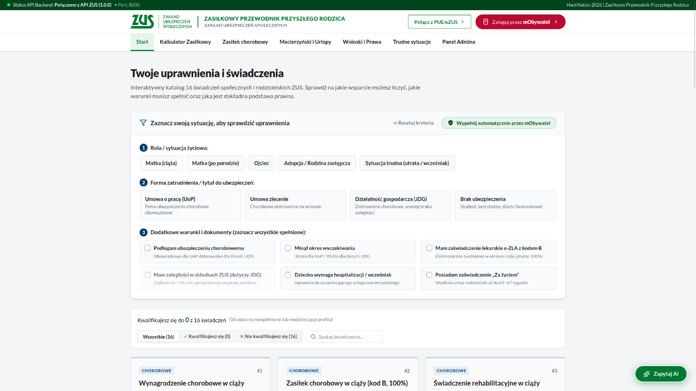

### Lista dostępnych świadczeń

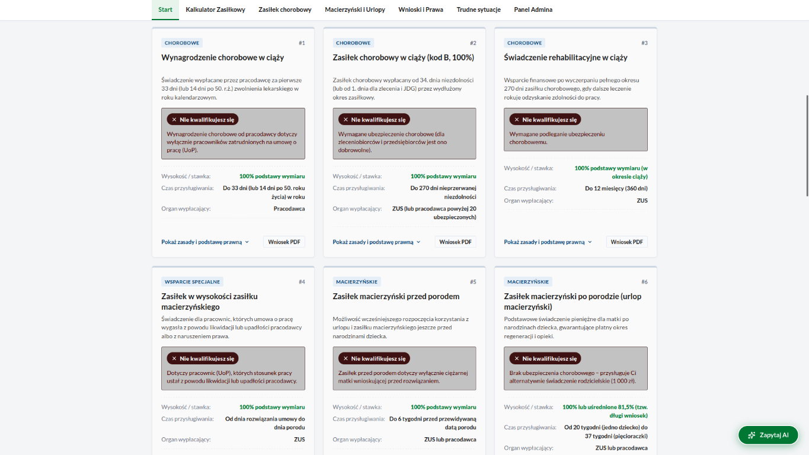

## 2. Wybór profilu demonstracyjnego

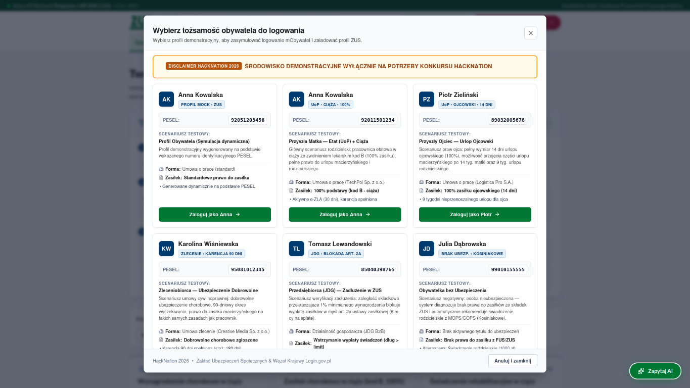

## 3. Zintegrowany kalkulator

### Formularz danych

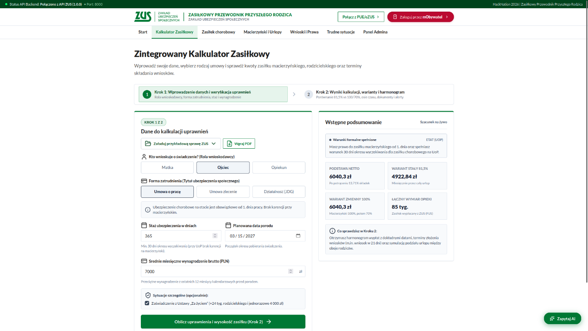

### Wynik kalkulatora

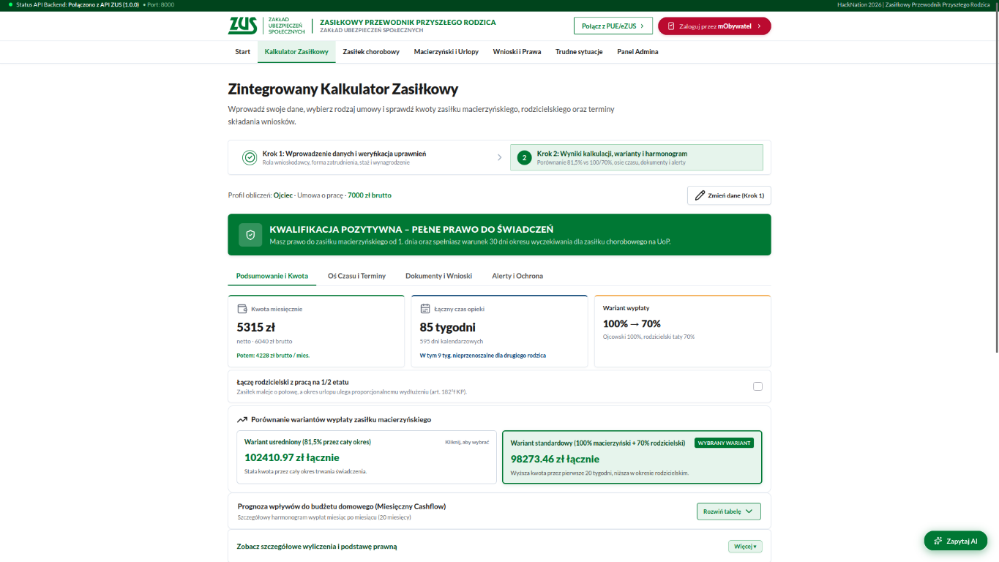

## 4. Oś czasu urlopów i świadczeń

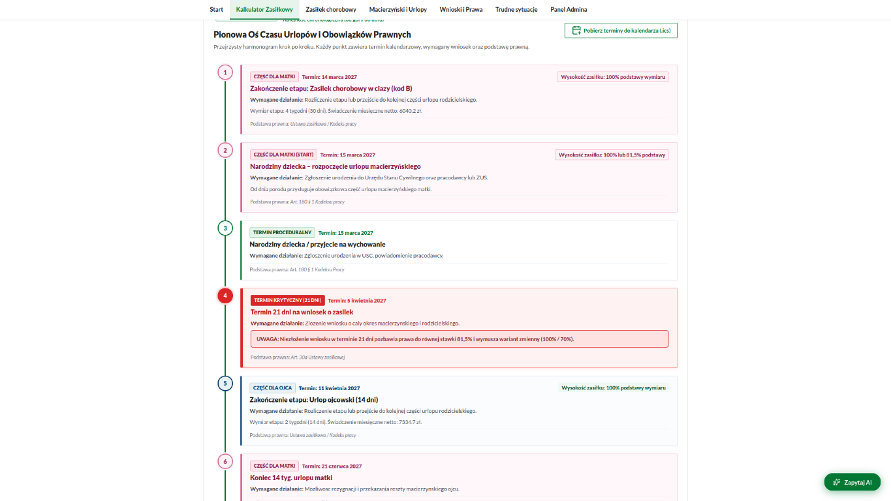

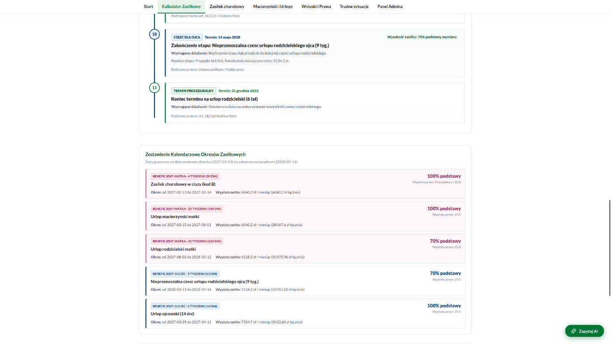

## 5. Porównanie wariantów i podsumowanie prawne

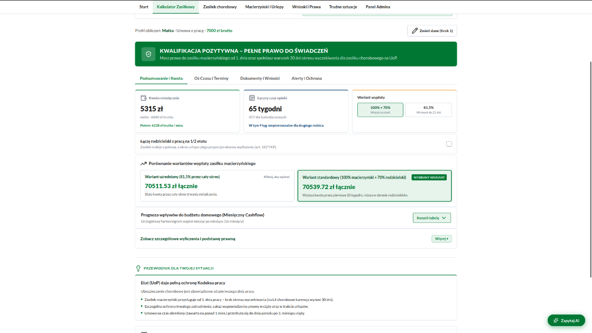

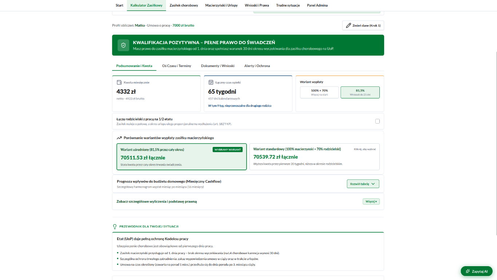

## 6. Panel parametrów administracyjnych

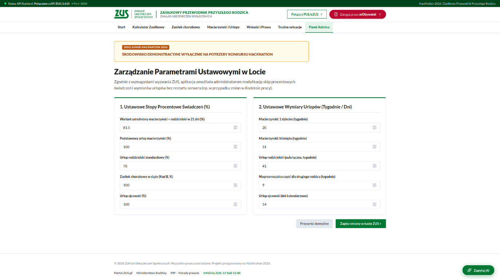

## 7. Kalkulator sytuacji szczególnych

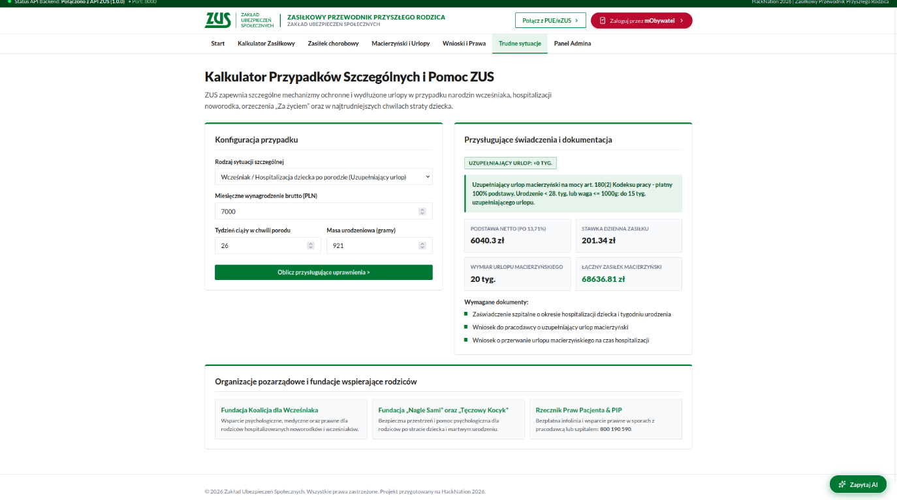
